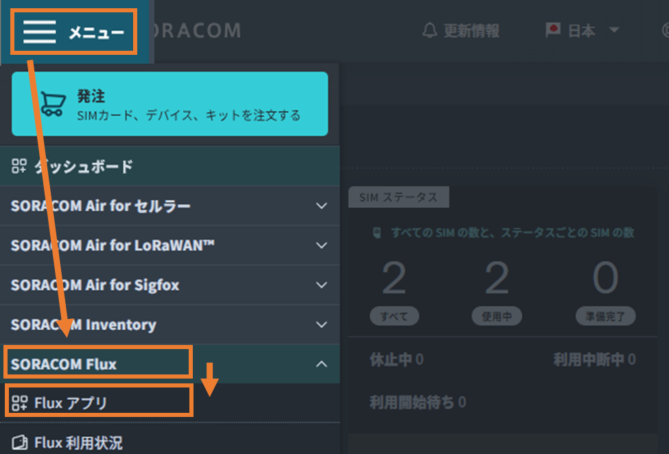
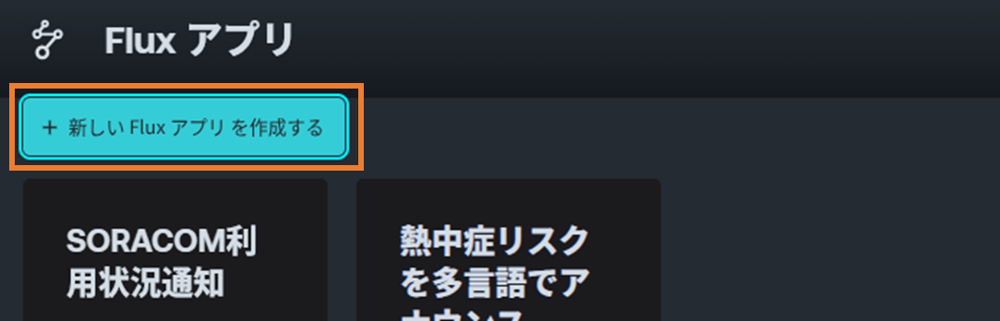
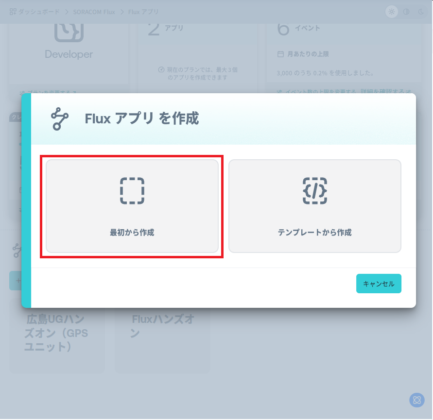
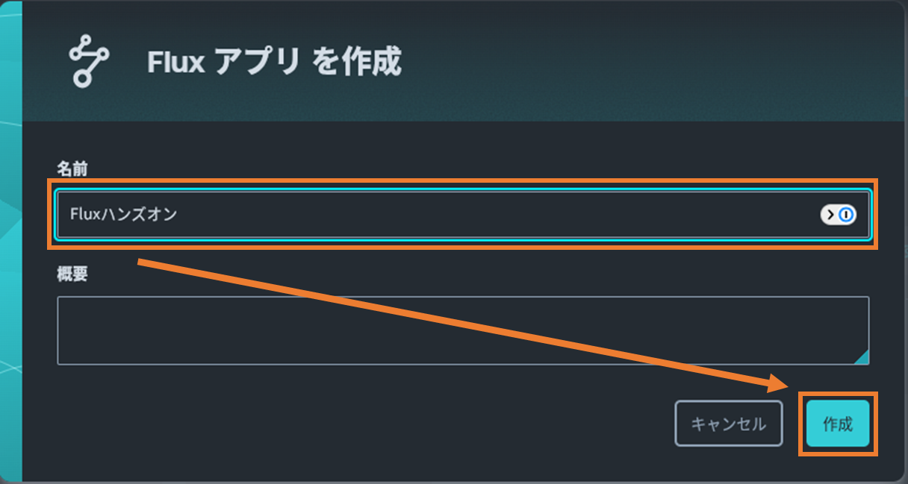
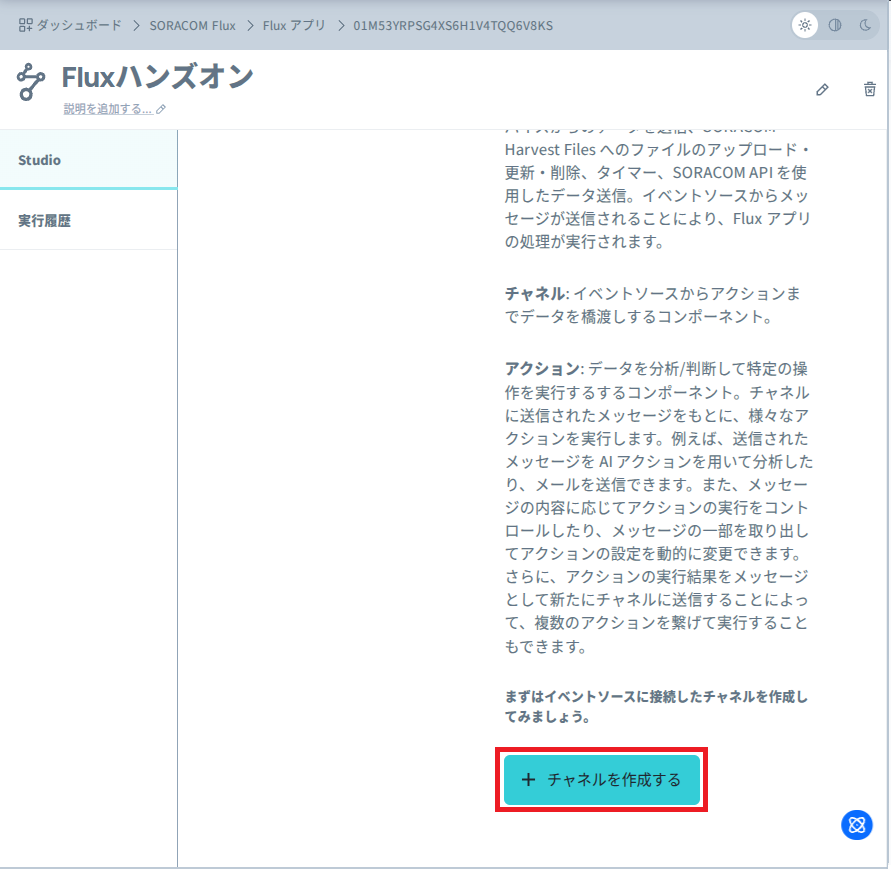
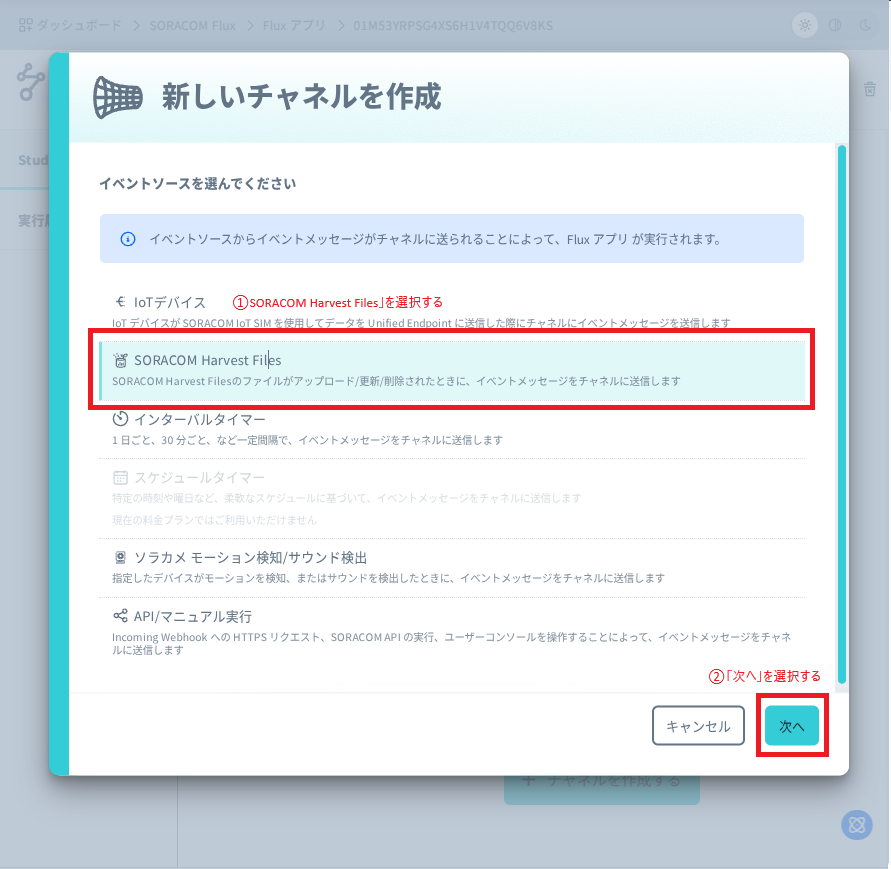
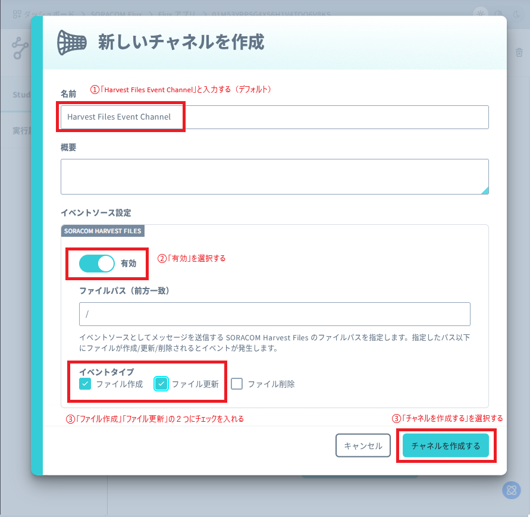

# 4. SORACOM Flux でメーター読み取り＋Discord通知を作る（本題）

ここが本題です。Flux アプリをゼロから作り、**トリガー → AI判定 → Discord通知**の3ブロックをつなぎます。

完成イメージ:

```
[SORACOM HARVEST FILES]  →  [AI: 数値読み取り]  →  [WEBHOOK: Discord通知]
   Harvest Files Event        Gemini 2.5             読み取り結果を
   Channel（トリガー）         Flash-Lite             Discordへ通知
```

## 4-0. Fluxアプリを作成する

1. SORACOM ユーザーコンソールの左上メニューから「Fluxアプリ」を選択します。

   

2. 「＋新しいアプリを作成する」をクリックします。

   

3. 「最初から作成」をクリックします。

   

4. 名前（例: `Fluxハンズオン`）を入力し、「作成」をクリックします。

   

## 4-1. トリガー：Harvest Files Event Channel

アプリが動き出すきっかけ（トリガー）を作ります。

1. 「＋チャネルを追加する」を選択します。

   

2. 「SORACOM Harvest Files」を選択し、「次へ」をクリックします。

   

3. チャネルを設定します。
   - **名前**: `Harvest Files Event Channel`
   - **ファイルパス（前方一致）**: `/`（すべてのアップロードを対象にする場合。特定フォルダだけなら `/meters` など）
   - **イベントタイプ**: `ファイル作成` と `ファイル更新` にチェック（`ファイル削除` はオフ）
   - **有効**: オン

   

4. 「チャネルを作成する」をクリックします。

## 4-2. AIブロック：数値読み取り（Google Gemini）

アップロードされた画像を AI に解析させ、メーターの値を JSON で取り出します。

1. 「アクション」タブをクリックし、「アクションを追加」をクリックします。
2. 「AI」を選択し、「OK」をクリックします。
3. 設定します。
   - **名前**: `数値読み取り`
   - **実行条件（CONDITION）**: **空のままにします**（常に実行）。
     ※ 入力欄に薄く表示される `payload.temperature > 24` は入力例（プレースホルダ）です。実際には入力しません。条件を入れたい場合のみ記入します。
   - **AIモデル**: `Google Gemini 2.5 Flash-Lite`
   - **プロンプト**: 以下をそのまま貼り付けます。
   - **AIからの返答を JSON 形式にする**: チェックを入れます。
   - **AIに画像を読み込ませる**: チェックを入れ、**画像リスト**に次を入力します（配列表記）。

     ```
     ["${event.payload.presignedUrls.get}"]
     ```

   - **アクションのアウトプットを別のチャネルに送信する**: `有効` にします。
   - **送信先チャネル**: 「新しくチャネルを作成する」を選び、チャネル名に `Output` を入力します（既にある場合は「既存のチャネルを選択する」で `Output` を選択）。
4. 「作成する」をクリックします。

**貼り付けるプロンプト:**

```text
あなたは、画像からメーターの値を読み取る優秀なアシスタントです。

添付された画像を解析し、表示されている数値を読み取ってください。

出力は必ず次のJSON形式のみとし、他の文章・説明は一切含めないでください。

{
  "meter_value": "読み取った値"
}

制約:
- meter_value は1つの文字列にしてください。複数の値がある場合は、カンマ区切りで1つの文字列にまとめてください（例: "12:38, 23.6, 10, 25, 25.0, 52%"）。
- meter_value の中にダブルクォート(")、角括弧([])、改行を含めないでください。
- 配列やオブジェクトでは返さないでください。
- 値が読み取れない場合は meter_value を null にしてください。
```

> **ポイント**: このプロンプトは「必ず JSON 1オブジェクトだけ返す」「値は1つの文字列にまとめる」「読めなければ null」と厳密に指示しています。後続の Discord 通知で `${payload.output.meter_value}` を素直に埋め込めるようにするための工夫です。

## 4-3. Webhookブロック：Discord通知

読み取った値を Discord に通知します。

> **Discord Webhook URL について**
> 今回のハンズオンで使う **Discord Webhook URL は Connpass の「参加者への情報」（参加者・発表者のみに公開）** で案内します。
> （参考）自分で用意する場合は、Discord のサーバー設定 →「連携サービス」→「ウェブフック」→「新しいウェブフック」で作成し、「ウェブフックURLをコピー」で取得します。この URL を知っている人は誰でもそのチャンネルに投稿できるため、**公開・共有しないでください**。

1. 「Output」チャネルを選択した状態で、「アクション」タブの「アクションを追加」をクリックします。
2. 「Webhook」を選択し、「OK」をクリックします。
3. 設定します。
   - **名前**: `Discord通知`
   - **実行条件（CONDITION）**: **空のまま**（常に実行）。※薄い `payload.temperature > 24` は入力例です。
   - **HTTPメソッド**: `POST`
   - **URL**: Connpass の「参加者への情報」に記載された Discord Webhook URL を入力します。

     ```
     Connpass の「参加者への情報」を参照
     ```

   - **認証方法**: `なし`
   - **HTTPヘッダー**: `content-type` = `application/json`
   - **HTTPボディ**: `application/json` を選び、以下を貼り付けます。`【名前やニックネーム】`は自分が分かる名前に書き換えてください。

     ```json
     {
       "content": "【名前やニックネーム】撮影したメータの数値を取得しました。\n読み取った数値：${payload.output.meter_value}",
       "embeds": [
         {
           "image": { "url": "${event.payload.presignedUrls.get}" }
         }
       ]
     }
     ```

     > **ポイント**: 画像は `content` に URL を直接書くと長い文字列がそのまま表示されてしまいます。上のように `embeds` の `image.url` に入れると、Discord が画像をプレビュー表示し、URL 文字列は見えなくなります。
     > ※ この画像 URL（presigned URL）は一定時間（既定で約1時間）で失効し、その後は画像を開けなくなります。これは仕様です。

   - **アクションのアウトプットを別のチャネルに送信する**: `無効`（ここが終点なので送信不要）。
4. 「作成する」をクリックします。

## 4-4. テスト実行

1. もう一度アプリに戻り、**新しいメーターの画像をアップロード**します。
2. しばらくすると、Discord のチャンネルに読み取り結果と画像リンクが届きます。届けば成功です 🎉

## うまくいかない場合：実行履歴の確認

通知が届かない／エラーが出る場合は、Flux の実行履歴で原因を特定できます。

1. 作成した Flux アプリの画面で「実行履歴」タブをクリックします。
2. 実行されたフローの一覧が表示されます。最新のステータスが `FAILED` になっていないか確認します。
3. 履歴をクリックすると、トリガーから各アクションまでの入出力データ（ペイロード）を確認できます。
4. どこで失敗しているか、データが正しく渡っているかを見て設定を見直してください。

よくあるつまずき:

- **AIが読めず `meter_value` が null** → 画像がブレている／数値が小さい。縮小アップロードでも読める構図で撮り直す。
- **Discordに届かない** → Webhook URL の誤り、`content-type: application/json` 未設定、HTTPボディの JSON 崩れ（特に `\n` やカンマ）を確認。
- **AIブロックの出力がそのまま流れない** → AIブロックの「アウトプットを別のチャネル（Output）に送信」が有効か、Discordブロックが `Output` チャネルに属しているかを確認。

---

[← 3. SORACOM Harvest Files での確認](./03-harvest-files.md) ｜ [目次](./README.md) ｜ [5. 一通りうまくいったら →](./05-advanced.md)
