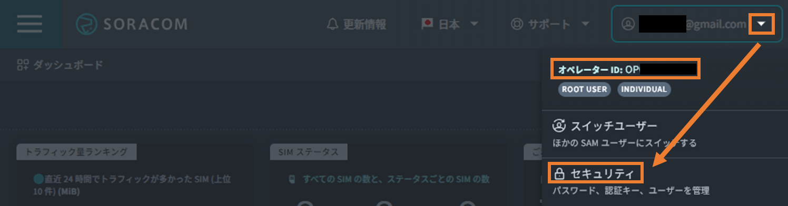
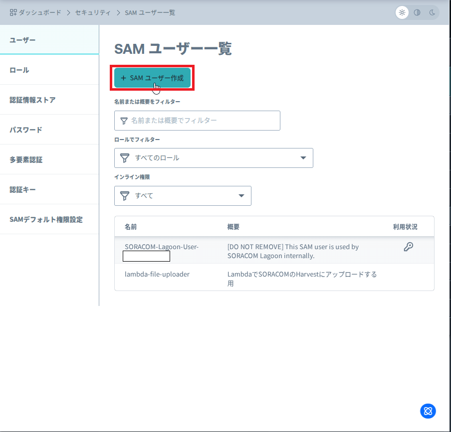
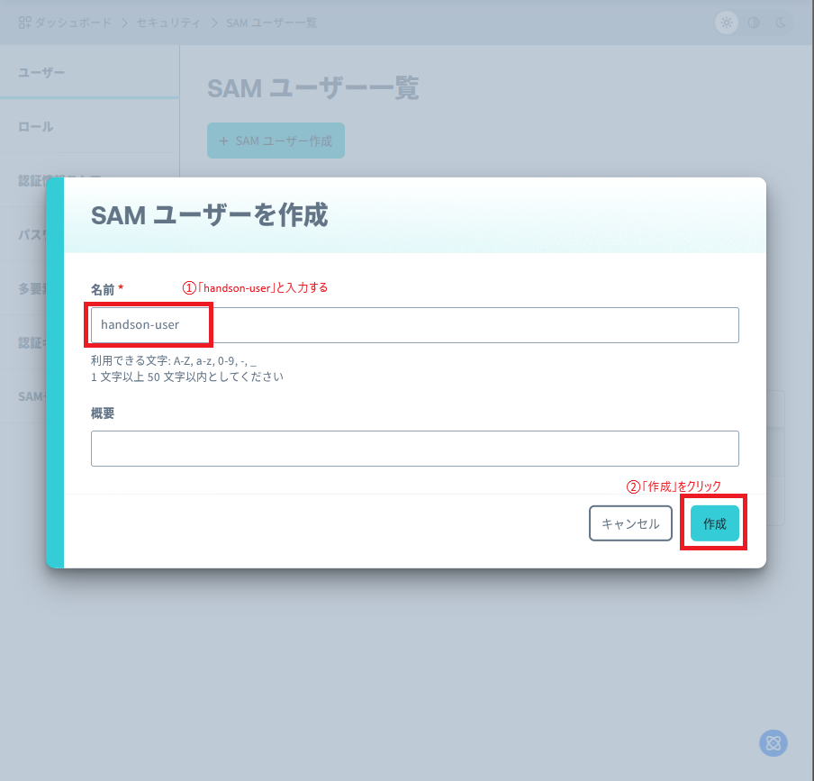
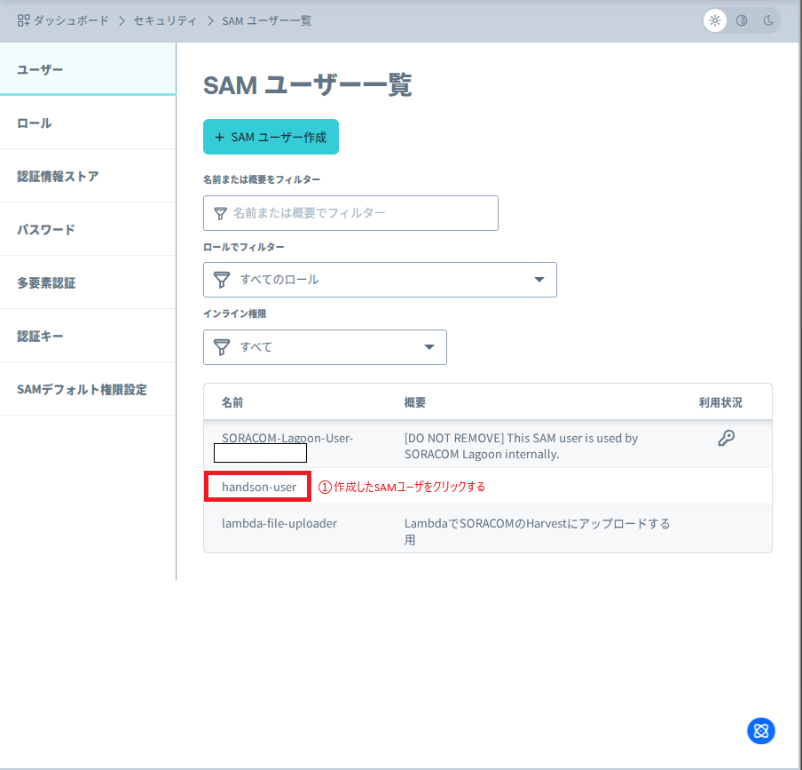
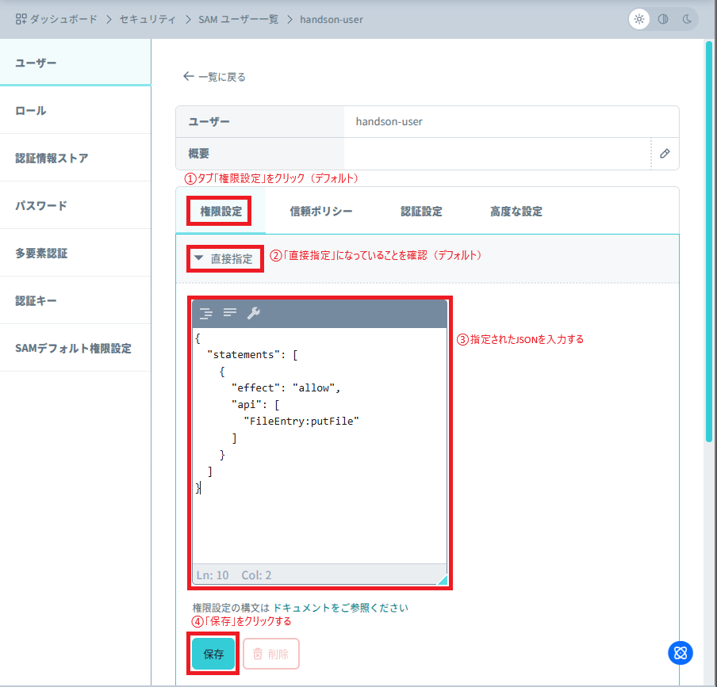
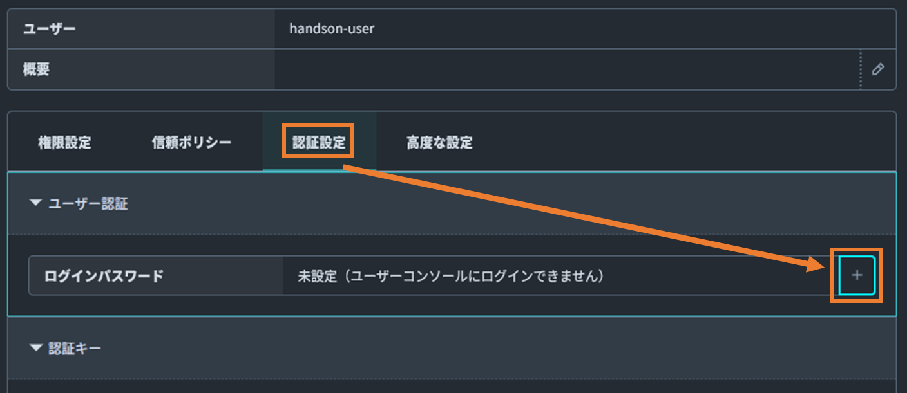
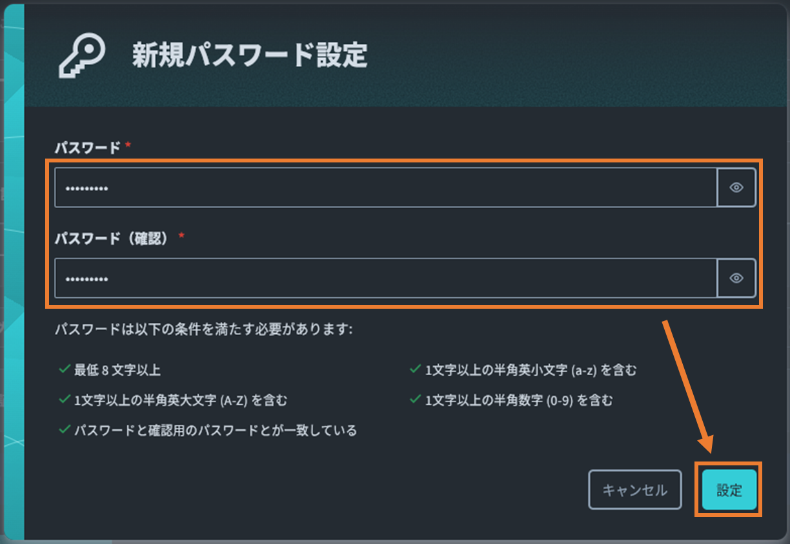
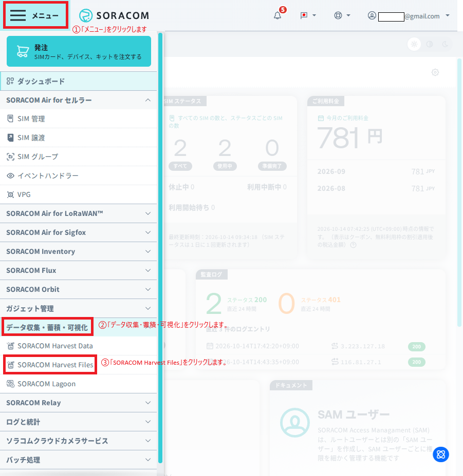
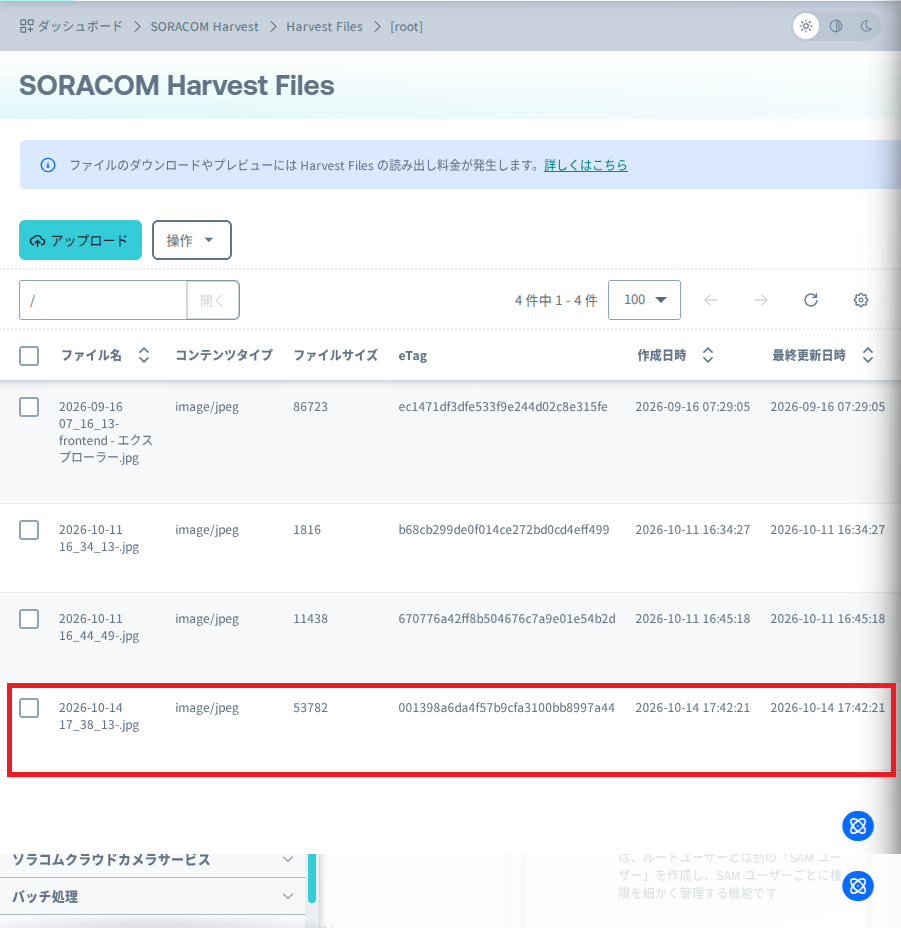

# SORACOM Flux AI画像判定ハンズオン


スマートフォンやパソコンで撮影・アップロードした画像から、**AI がメーターの数値を自動で読み取り、Discord に通知する**までを体験するハンズオン資料です。

## このハンズオンの主役

アップロード用の Web アプリ（[soracom-harvest-uploader](https://github.com/tyamon1006/soracom-harvest-uploader)）は「画像をアップロードするための入口」にすぎません。
**本題は、アップロードをトリガーに Flux 上で AI が画像を判定し、結果を通知するパイプラインを自分で組み立てること**です。

```
スマホ / PC で撮影・アップロード
  │  ① アップローダアプリ（入口／使い方だけ簡単に説明）
  ▼
SORACOM Harvest Files
  │  ② ファイル作成/更新イベント（トリガー）
  ▼
SORACOM Flux
  ├─ Harvest Files Event Channel … トリガー
  ├─ AIブロック「数値読み取り」    … Gemini 2.5 Flash-Lite が画像→メーター値をJSON抽出
  └─ Webhook「Discord通知」        … 読み取り結果をDiscordへ通知
```

> **注意**: 本資料内の Discord Webhook URL・ログイン情報・認証キーはすべてプレースホルダ（例: `<当日案内されるDiscord Webhook URL>`）です。実運用の値はコミットしないでください（当日の運用は末尾「最後に」を参照）。

---

## はじめに

### このハンズオンの背景（ストーリー）

あなたは、とある工場の担当者です。
あなたの仕事は、広大な工場内に点在する大量のデジタル・アナログメーターを一つ一つ目視で確認し、値を記録することです。この作業には毎回2日もかかっていました。

特に夏の作業は過酷で、熱中症のリスクと常に隣り合わせです。月に1回のこの作業だけでも大きな負担なのに、先日、上層部から「記録頻度をもっと増やしてほしい」という指示が出てしまいました。

> **「今のやり方のままでは、もう限界だ…」**

何か良い方法はないかと探していたあなたは、IoTプラットフォーム「SORACOM」の存在を知ります。
「**ソラカメ**（クラウドカメラ）と、IoTデバイスから得たデータに通知や生成AIによる分析などのアクションを組み合わせて業務を効率化できるサービス **SORACOM Flux** を使えば、カメラで撮影した画像からメーターの値を自動で読み取り、記録業務を自動化できるのではないか？」

このアイデアを検証するため、最初の PoC（概念実証）として、**「まずは手持ちのスマートフォンやパソコンで撮影・アップロードした画像から、本当にメーターの値を読み取れるか試してみよう」** と考えました。

このハンズオンでは、その PoC を体験します。

### 今回利用する SORACOM サービス

#### SORACOM Flux

「もし〇〇が起きたら、△△を実行する」という処理の自動化を、プログラミングの知識がなくても実現できるサービスです。トリガーやアクションの部品をつなぎ合わせるだけで IoT のワークフローを構築できます。
今回は「**Harvest Files に新しい画像がアップロードされたら（トリガー）、その画像を AI で解析してメーターの値を読み取り、Discord に通知する（アクション）**」という流れを作ります。

→ [SORACOM Flux の詳細](https://soracom.jp/services/flux/)

#### SORACOM Harvest Files

IoTデバイスから送られてくる画像・ログ・センサーデータなどのファイルを手軽に保存・管理できるクラウドストレージです。指定された場所にファイルを送るだけで安全にデータを保管できます。今回は、スマートフォンやパソコンで撮影・アップロードしたメーター画像をここに保存します。
→ [SORACOM Harvest の詳細](https://soracom.jp/services/harvest/)

#### 【参考】SAM（SORACOM Access Management）ユーザー

SORACOM のサービスを安全に利用するための仕組みです。大きな権限を持つ「ルートユーザー」の代わりに、限定的な権限だけを持つ「SAMユーザー」を作成することで、第三者が操作する際のリスクを最小化できます。今回作成する SAM ユーザーには「ファイルをアップロードする権限」だけを与えます。
→ [SAM の詳細](https://users.soracom.io/ja-jp/docs/sam/)

### このハンズオンの目的（ゴール）

次のパイプラインを **自分の手で組み立てて動かす**ことがゴールです。

1. スマートフォンやパソコンで撮影・アップロードした画像を SORACOM Harvest Files へ保存する（アプリの役割はここだけ）
2. アップロードをトリガーに **SORACOM Flux** を起動する
3. Flux の **AIブロック**（Google Gemini）が画像内のメーターの値を読み取る
4. 読み取った値を **Discord** に通知する

アプリ自体は「アップロードの入口」にすぎません。主役は **2〜4 の Flux パイプライン**です。

---

## 1. SAMユーザーの作成

まず、SORACOM ユーザーコンソールにログインし、ファイルアップロード権限を持つ SAM ユーザーを作成します。

1. SORACOM ユーザーコンソールにログインします。
2. 右上のメニューから「セキュリティ」を選択します。このとき **オペレーターID** も確認し、メモしておいてください。

   

3. 「SAMユーザー」を選択し、「SAMユーザーを作成」ボタンをクリックします。

   

4. 名前（例: `handson-user`）を入力し、「作成」ボタンをクリックします。

   

5. 作成したユーザーの名前（例: `handson-user`）をクリックします。

   

6. 「権限設定」で「直接指定」を選択し、以下の JSON を貼り付けて「保存」をクリックします。

   

   ```json
   {
     "statements": [
       {
         "effect": "allow",
         "api": [
           "FileEntry:putFile"
         ]
       }
     ]
   }
   ```

   > これにより、Harvest Files への書き込み権限のみが付与されます。

7. 「認証設定」を選択し、「ログインパスワード」の右側の「+」ボタンをクリックします。

   

8. 任意のパスワードを入力し、「設定」ボタンをクリックします。**このパスワードは後で使うのでメモ**してください。

   

> このステップで作成した「SAMユーザー名」「パスワード」、そして自分の「オペレーターID」を次のステップで使います。

---

## 2. アプリでのログインとファイルアップロード

> このステップはお手持ちのスマートフォンまたはパソコンで実施してください。

アプリは「画像をアップロードする入口」です。使い方だけ簡単に押さえます。

1. アップロードページにアクセスします（イベント当日に案内される URL / QRコード）。
2. 「ログイン」ボタンを押し、イベント用に案内された認証情報でログインします。

   | 項目 | 値 |
   | :--- | :--- |
   | メールアドレス | `<当日案内されるメールアドレス>` |
   | パスワード | `<当日案内されるパスワード>` |

3. ログイン後、以下の情報を入力します。
   - **オペレーターID**: 手順1で確認したオペレーターID
   - **SAMユーザー名**: 手順1で作成した SAM ユーザー名
   - **パスワード**: 手順1で設定したパスワード
   - **アップロード先フォルダ**: 任意（例: `/meters`）。空欄でもOK
4. 「ファイルを選択」または「カメラで撮影」で、メーターの画像を選びます（パソコンの場合は保存済みの画像ファイルを選択）。
5. 「画像を縮小してアップロード」にチェックが入っていることを確認します（Flux のタイムアウト防止のため推奨）。
6. 「アップロード」ボタンをクリックします。
7. 「アップロード成功！」が表示されれば完了です。

---

## 3. SORACOM Harvest Files での確認

アップロードしたファイルが正しく保存されているか確認します。

1. SORACOM ユーザーコンソールに戻ります。
2. 左上のメニューから「SORACOM Harvest Files」を選択します。

   

3. ファイル一覧に、アップロードした画像が表示されていることを確認します。ファイル名をクリックするとプレビュー／ダウンロードできます。

   

---

## 4. SORACOM Flux でメーター読み取り＋Discord通知を作る（本題）

ここが本題です。Flux アプリをゼロから作り、**トリガー → AI判定 → Discord通知**の3ブロックをつなぎます。

完成イメージ:

```
[SORACOM HARVEST FILES]  →  [AI: 数値読み取り]  →  [WEBHOOK: Discord通知]
   Harvest Files Event        Gemini 2.5             読み取り結果を
   Channel（トリガー）         Flash-Lite             Discordへ通知
```

### 4-0. Fluxアプリを作成する

1. SORACOM ユーザーコンソールの左上メニューから「Fluxアプリ」を選択します。

   

2. 「＋新しいアプリを作成する」をクリックします。

   

3. 「最初から作成」をクリックします。

   

4. 名前（例: `Fluxハンズオン`）を入力し、「作成」をクリックします。

   

### 4-1. トリガー：Harvest Files Event Channel

アプリが動き出すきっかけ（トリガー）を作ります。

1. 「＋チャネルを追加する」を選択します。

   

2. 「SORACOM Harvest Files」を選択し、「次へ」をクリックします。

   

3. チャネルを設定します。
   - **名前**: `Harvest Files Event Channel`
   - **ファイルパス（前方一致）**: `/`（すべてのアップロードを対象にする場合。特定フォルダだけなら `/meters` など）
   - **イベントタイプ**: `ファイル作成` と `ファイル更新` にチェック（`ファイル削除` はオフ）
   - **有効**: オン

   

4. 「チャネルを作成する」をクリックします。

### 4-2. AIブロック：数値読み取り（Google Gemini）

アップロードされた画像を AI に解析させ、メーターの値を JSON で取り出します。

1. 「アクション」タブをクリックし、「アクションを追加」をクリックします。
2. 「AI」を選択し、「OK」をクリックします。
3. 設定します。
   - **名前**: `数値読み取り`
   - **実行条件（CONDITION）**: **空のままにします**（常に実行）。
     ※ 入力欄に薄く表示される `payload.temperature > 24` は入力例（プレースホルダ）です。実際には入力しません。条件を入れたい場合のみ記入します。
   - **AIモデル**: `Google Gemini 2.5 Flash-Lite`
   - **プロンプト**: 以下をそのまま貼り付けます。
   - **AIからの返答を JSON 形式にする**: チェックを入れます。
   - **AIに画像を読み込ませる**: チェックを入れ、**画像リスト**に次を入力します（配列表記）。

     ```
     ["${event.payload.presignedUrls.get}"]
     ```

   - **アクションのアウトプットを別のチャネルに送信する**: `有効` にします。
   - **送信先チャネル**: 「新しくチャネルを作成する」を選び、チャネル名に `Output` を入力します（既にある場合は「既存のチャネルを選択する」で `Output` を選択）。
4. 「作成する」をクリックします。

**貼り付けるプロンプト:**

```text
あなたは、画像からメーターの値を読み取る優秀なアシスタントです。

添付された画像を解析し、表示されている数値を読み取ってください。

出力は必ず次のJSON形式のみとし、他の文章・説明は一切含めないでください。

{
  "meter_value": "読み取った値"
}

制約:
- meter_value は1つの文字列にしてください。複数の値がある場合は、カンマ区切りで1つの文字列にまとめてください（例: "12:38, 23.6, 10, 25, 25.0, 52%"）。
- meter_value の中にダブルクォート(")、角括弧([])、改行を含めないでください。
- 配列やオブジェクトでは返さないでください。
- 値が読み取れない場合は meter_value を null にしてください。
```

> **ポイント**: このプロンプトは「必ず JSON 1オブジェクトだけ返す」「値は1つの文字列にまとめる」「読めなければ null」と厳密に指示しています。後続の Discord 通知で `${payload.output.meter_value}` を素直に埋め込めるようにするための工夫です。

### 4-3. Webhookブロック：Discord通知

読み取った値を Discord に通知します。

> **Discord Webhook URL について**
> 今回のハンズオンで使う **Discord Webhook URL は当日ご案内します**。
> （参考）自分で用意する場合は、Discord のサーバー設定 →「連携サービス」→「ウェブフック」→「新しいウェブフック」で作成し、「ウェブフックURLをコピー」で取得します。この URL を知っている人は誰でもそのチャンネルに投稿できるため、**公開・共有しないでください**。

1. 「Output」チャネルを選択した状態で、「アクション」タブの「アクションを追加」をクリックします。
2. 「Webhook」を選択し、「OK」をクリックします。
3. 設定します。
   - **名前**: `Discord通知`
   - **実行条件（CONDITION）**: **空のまま**（常に実行）。※薄い `payload.temperature > 24` は入力例です。
   - **HTTPメソッド**: `POST`
   - **URL**: 当日案内される Discord Webhook URL を入力します。

     ```
     <当日案内されるDiscord Webhook URL>
     ```

   - **認証方法**: `なし`
   - **HTTPヘッダー**: `content-type` = `application/json`
   - **HTTPボディ**: `application/json` を選び、以下を貼り付けます。`【名前やニックネーム】`は自分が分かる名前に書き換えてください。

     ```json
     {
       "content": "【名前やニックネーム】撮影したメータの数値を取得しました。\n読み取った数値：${payload.output.meter_value}",
       "embeds": [
         {
           "image": { "url": "${event.payload.presignedUrls.get}" }
         }
       ]
     }
     ```

     > **ポイント**: 画像は `content` に URL を直接書くと長い文字列がそのまま表示されてしまいます。上のように `embeds` の `image.url` に入れると、Discord が画像をプレビュー表示し、URL 文字列は見えなくなります。
     > ※ この画像 URL（presigned URL）は一定時間（既定で約1時間）で失効し、その後は画像を開けなくなります。これは仕様です。

   - **アクションのアウトプットを別のチャネルに送信する**: `無効`（ここが終点なので送信不要）。
4. 「作成する」をクリックします。

### 4-4. テスト実行

1. もう一度アプリに戻り、**新しいメーターの画像をアップロード**します。
2. しばらくすると、Discord のチャンネルに読み取り結果と画像リンクが届きます。届けば成功です 🎉

---

## うまくいかない場合：実行履歴の確認

通知が届かない／エラーが出る場合は、Flux の実行履歴で原因を特定できます。

1. 作成した Flux アプリの画面で「実行履歴」タブをクリックします。
2. 実行されたフローの一覧が表示されます。最新のステータスが `FAILED` になっていないか確認します。
3. 履歴をクリックすると、トリガーから各アクションまでの入出力データ（ペイロード）を確認できます。
4. どこで失敗しているか、データが正しく渡っているかを見て設定を見直してください。

よくあるつまずき:

- **AIが読めず `meter_value` が null** → 画像がブレている／数値が小さい。縮小アップロードでも読める構図で撮り直す。
- **Discordに届かない** → Webhook URL の誤り、`content-type: application/json` 未設定、HTTPボディの JSON 崩れ（特に `\n` やカンマ）を確認。
- **AIブロックの出力がそのまま流れない** → AIブロックの「アウトプットを別のチャネル（Output）に送信」が有効か、Discordブロックが `Output` チャネルに属しているかを確認。

---

## 一通りうまくいったら

プロンプトを変えると、いろんな画像で遊べます。下の例は **AIブロックのプロンプト**と **Discordブロックの HTTPボディ** をセットで差し替えると動きます。

まずは自分で考えてみてから、答え合わせに各「▶ プロンプトとHTTPボディの例を見る」を開いてください。
（ポイントは、プロンプトで「必ずこの JSON だけを返す」と指示し、その JSON のキーを HTTPボディの `${payload.output.キー名}` で受け取ることです。）

### 別の画像で試してみる

プロンプトを差し替えるだけで、メーター以外のいろんな画像を判定できます。下の例は **AIブロックのプロンプト**と **Discordブロックの HTTPボディ** をセットで差し替えると動きます。

#### 例1：料理の画像から、おいしさ・栄養を判定する

<details>
<summary>▶ プロンプトとHTTPボディの例を見る</summary>

**AIブロックのプロンプト:**

```text
あなたは、料理写真を評価する優秀な管理栄養士です。

添付された画像の料理を解析してください。

出力は必ず次のJSON形式のみとし、他の文章・説明は一切含めないでください。

{
  "dish": "料理名",
  "yummy_score": "0〜100のおいしそう度（数値を文字列で）",
  "nutrition": "主な栄養素を1つの文字列でカンマ区切り（例: たんぱく質, 脂質, ビタミンC）",
  "comment": "一言コメント"
}

制約:
- 各値は1つの文字列にしてください。配列やオブジェクトでは返さないでください。
- 値の中にダブルクォート(")、角括弧([])、改行を含めないでください。
- 判定できない場合は該当の値を null にしてください。
```

**Discordブロックの HTTPボディ:**

```json
{
  "content": "【名前】料理を判定しました。\n料理：${payload.output.dish}\nおいしそう度：${payload.output.yummy_score}/100\n栄養：${payload.output.nutrition}\n一言：${payload.output.comment}",
  "embeds": [
    {
      "image": { "url": "${event.payload.presignedUrls.get}" }
    }
  ]
}
```

</details>

#### 例2：顔写真から、気分を判定する

<details>
<summary>▶ プロンプトとHTTPボディの例を見る</summary>

**AIブロックのプロンプト:**

```text
あなたは、表情から気分を推定する優秀なアシスタントです。

添付された画像に写っている人物の表情を解析してください。

出力は必ず次のJSON形式のみとし、他の文章・説明は一切含めないでください。

{
  "mood": "推定した気分を表す1語（例: 笑顔, 真顔, 困り顔）",
  "confidence": "0〜100の確信度（数値を文字列で）",
  "comment": "気分に合わせた一言メッセージ"
}

制約:
- 各値は1つの文字列にしてください。配列やオブジェクトでは返さないでください。
- 値の中にダブルクォート(")、角括弧([])、改行を含めないでください。
- 人物が写っていない／判定できない場合は各値を null にしてください。
```

**Discordブロックの HTTPボディ:**

```json
{
  "content": "【名前】気分を判定しました。\n気分：${payload.output.mood}（確信度 ${payload.output.confidence}%）\n一言：${payload.output.comment}",
  "embeds": [
    {
      "image": { "url": "${event.payload.presignedUrls.get}" }
    }
  ]
}
```

</details>

#### 例3：ホワイトボードや手書きメモの文字を読み取る

<details>
<summary>▶ プロンプトとHTTPボディの例を見る</summary>

**AIブロックのプロンプト:**

```text
あなたは、画像内の手書き文字を正確に読み取る優秀なアシスタントです。

添付された画像（ホワイトボードや手書きメモ）に書かれている文字を読み取ってください。

出力は必ず次のJSON形式のみとし、他の文章・説明は一切含めないでください。

{
  "text": "読み取った本文を1つの文字列で（改行は含めず、半角スペースで区切る）",
  "summary": "内容を一言で要約",
  "readable": "はっきり読み取れた場合は yes、読み取りにくい場合は no"
}

制約:
- 各値は1つの文字列にしてください。配列やオブジェクトでは返さないでください。
- 値の中にダブルクォート(")、角括弧([])、改行を含めないでください。
- 文字が読み取れない場合は該当の値を null にしてください。
```

**Discordブロックの HTTPボディ:**

```json
{
  "content": "【名前】手書きメモを読み取りました。\n本文：${payload.output.text}\n要約：${payload.output.summary}\n読み取り：${payload.output.readable}",
  "embeds": [
    {
      "image": { "url": "${event.payload.presignedUrls.get}" }
    }
  ]
}
```

</details>

「画像を読み取る」という単純なことでも、生成AIの力を借りればアイデア次第でいろんなことが可能です。プロンプトとHTTPボディの `${payload.output.キー名}` を対応させるのがコツです。

### AIモデルを変えてみる

もう一つの切り口として、プロンプトはそのままに **AIモデルそのものを差し替えて**、精度や結果の違いを見比べることもできます。

<details>
<summary>▶ AIモデルの変え方とコストの注意を見る</summary>

ここまでは **Google Gemini 2.5 Flash-Lite** を使ってきました。同じ画像・同じプロンプトでも、モデルによって読み取り精度や表現が変わるので、ぜひ見比べてみてください。

**試し方（プロンプト・HTTPボディはそのままでOK）:**

1. AIブロックの **CONFIG → AIモデル** のプルダウンを開く
2. 別のモデル（例: `Google Gemini 2.5 Flash`、`Google Gemini 3.1 Flash-Lite`、`Amazon Bedrock – Amazon Nova Lite` など）を選ぶ
3. 保存して、同じ画像をもう一度アップロードし、結果の違いを見比べる

**おすすめの比べ方:**
- 読み取りにくいメーター（反射・ブレ・小さい数字）を、軽量モデルと上位モデルで比べる
- 例1〜3のプロンプト（料理・気分・ウォーリー）で、モデルごとの「コメント」の表現の違いを見る

> ⚠️ **コストの注意**: AIモデルは、1リクエストごとに消費する **クレジット数がモデルによって異なります**。高性能なモデルほど消費が大きくなります。ハンズオンでは、まず安価なモデルで試し、必要に応じて上位モデルを使うのがおすすめです。
>
> 参考（画像1枚あたりの消費クレジット・2026年10月時点の例）:
>
> | AIモデル | 消費クレジット |
> | :--- | ---: |
> | Google Gemini 2.5 Flash-Lite（本手順の既定） | 4 |
> | Google Gemini 3.1 Flash-Lite | 11 |
> | Google Gemini 2.5 Flash | 17 |
> | Amazon Bedrock – Amazon Nova Lite | 3 |
> | Google Gemini 2.5 Pro | 67 |
>
> 最新の消費クレジット・対応モデル・料金は必ず公式ページでご確認ください 👉 [SORACOM Flux の料金ページ](https://soracom.jp/services/flux/#pricing)
>
> ※ クレジットには無料枠があります（Developerプランは月150クレジットまで無料）。試す範囲なら通常は無料枠内に収まりますが、上位モデルを多数回すと無料枠を超えることがあります。

</details>

---

## まとめと次のステップ

お疲れ様でした。このハンズオンで次の流れを体験しました。

- Web アプリから SORACOM Harvest Files へ画像をアップロードする
- アップロードをトリガーに SORACOM Flux で **AIによる画像判定（メーター読み取り）** と **Discord通知** を実行する

これで **「現場からスマホやPCで写真を撮る・選ぶだけで、メーターの値を自動で収集・通知する」** という業務改善の第一歩を具体的に検証できました。

次のステップとしては、Flux が出力した値を **SORACOM Harvest Data** に保存し、**SORACOM Lagoon** でダッシュボード化して、メーター値を時系列で可視化していくことが考えられます。

---

## 最後に：リソースの後片付け

Harvest Files の利用には SORACOM 利用料が発生します。無駄な費用を抑えるため、使い終わったら以下を削除してください。

**Harvest Files のファイル削除**
1. ユーザーコンソール → 「SORACOM Harvest Files」。
2. 削除したいファイルを選択し、「削除」をクリック。

**SAMユーザーの削除**
1. ユーザーコンソール → 右上「セキュリティ」→「SAMユーザー」。
2. 対象ユーザー（例: `handson-user`）を選択し、「削除」をクリック。

**Fluxアプリの削除**
Harvest Files へのアップロードをトリガーにしているため、不意な実行を防ぐために削除をおすすめします。
1. ユーザーコンソール → 「Fluxアプリ」。
2. 対象アプリをクリック → 右上の「X」（Fluxアプリを削除）→「削除する」。

**（運営向け）当日公開した認証情報・URLの無効化**
当日、進行の都合でログイン情報（メールアドレス／パスワード）や Discord Webhook URL をこのリポジトリに追記して共有した場合は、イベント終了後に必ず以下を実施してください。
1. 追記した認証情報・URL を資料から削除し、コミットする（履歴に残る点に注意）。
2. **キー自体を無効化する**:
   - アプリのログインパスワードを変更、または当該ユーザーを削除する。
   - Discord Webhook は Discord 側で該当 Webhook を削除する（URL を知る全員が投稿できなくなる）。
   - SORACOM の SAM ユーザー／認証キーを使った場合は、該当キーを無効化・削除する。

