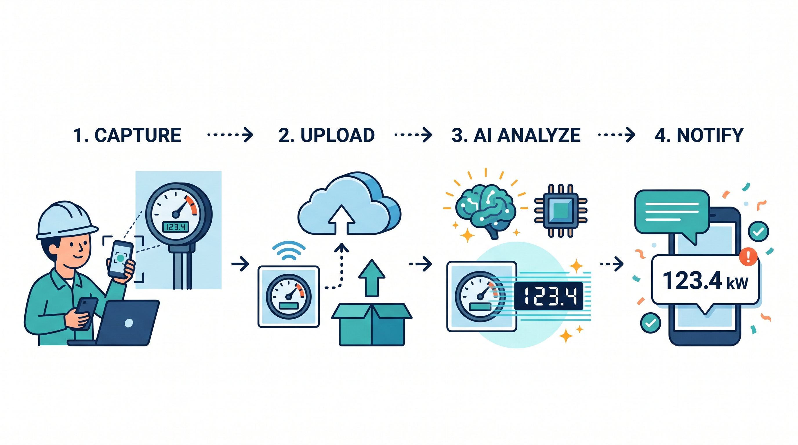

# スマホで撮った写真を AI が解析して Discord に届ける！SORACOM Flux AI画像判定ハンズオン



**あなたのスマホが AI カメラに！**
スマートフォンやパソコンで撮影・アップロードした画像を、**生成 AI が解析して SNS（今回は Discord）に通知する**までを体験するハンズオンです。温度計や時計の読み取り、部屋の人数の判定など、いろいろな画像で試してみましょう。

## このハンズオンでつくるもの

スマホ／PC で撮影した画像を SORACOM Harvest Files にアップロードすると、SORACOM Flux の AI アクションが画像を解析し、読み取った結果を Discord のチャンネルに投稿します。

```
スマホ / PC で撮影・アップロード
  │  ① アップローダアプリ（アップロード手段として使うデモアプリ）
  ▼
SORACOM Harvest Files
  │  ② ファイル作成/更新イベント（トリガー）
  ▼
SORACOM Flux
  ├─ Harvest Files Event Channel … トリガー
  ├─ AIブロック「数値読み取り」    … Gemini 2.5 Flash-Lite が画像→メーター値をJSON抽出
  └─ Webhook「Discord通知」        … 読み取り結果をDiscordへ通知
  ▼
Discord チャンネル
```

例として「メーターの数値を読み取る」を題材にしますが、同じ仕組みで温度計・時計の読み取りや、部屋の人数のカウントなど、いろいろな画像解析に応用できます。

## 学べること

- Web アプリから SORACOM Harvest Files へ画像をアップロードする流れ
- SORACOM Flux のトリガー（Harvest Files Event Channel）・AIブロック・Webhookブロックの組み立て方
- 生成 AI（Google Gemini）に画像を読み取らせ、結果を JSON で受け取る方法
- Discord Webhook を使った外部通知

## 所要時間の目安

約 60 分

## 事前準備

### 必要なもの

| 項目 | 内容 |
| :--- | :--- |
| アカウント | SORACOM アカウント（各自でご用意いただき、ご自身のアカウントでログインします） |
| 撮影機材 | スマートフォンまたはパソコン（カメラ or 画像ファイル） |
| Discord | 投稿先チャンネルが見られること（Webhook URL は Connpass の「参加者への情報」で案内） |
| PC | ブラウザが使えるもの |

> **注意**: 本資料内の アップローダアプリのサイトURL・ログイン情報・Discord Webhook URL はすべてプレースホルダです（SORACOM アカウントのログインは各自のものを使います）。これらの実際の値は **Connpass の「参加者への情報」（参加者・発表者のみに公開）** で当日までに案内します。実運用の値はこのリポジトリにコミットしないでください。

## 目次

1. [はじめに](./00-introduction.md)
2. [SAMユーザーの作成](./01-sam-user.md)
3. [アプリでのログインとファイルアップロード](./02-upload.md)
4. [SORACOM Harvest Files での確認](./03-harvest-files.md)
5. [SORACOM Flux でメーター読み取り＋Discord通知を作る（本題）](./04-flux.md)
6. [一通りうまくいったら（応用）](./05-advanced.md)
7. [後片付け](./06-cleanup.md)
8. [参考リンク](./07-references.md)
